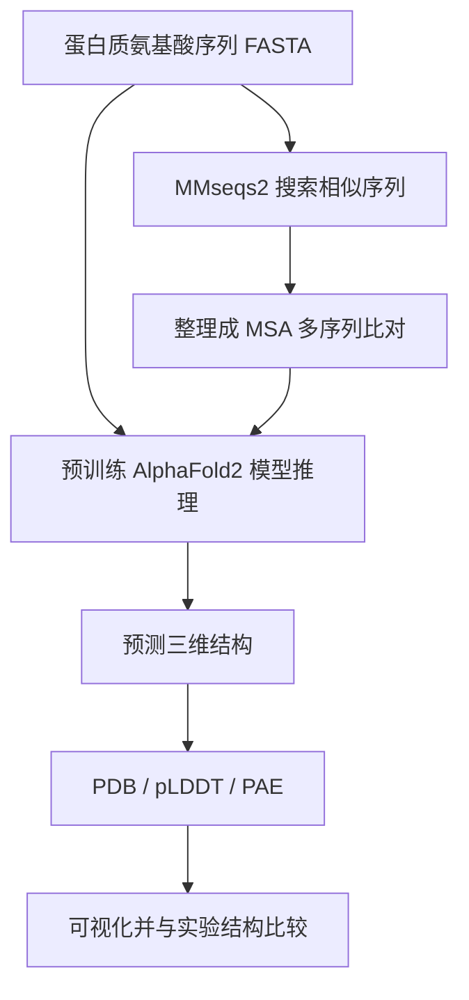

# ColabFold 快速验证：部署与第一次蛋白质结构预测

面向课题组入门的部署手册，按 Linux 服务器、双 NVIDIA RTX A5000（每卡 24 GB 显存）和 400 GB 系统内存编写。

> **目标：**部署 LocalColabFold，用公开蛋白序列做结构预测并学会解读结果。这是预训练模型推理，不是训练；不预测小分子结合，也不需要藏医药分子库。

## 1. 流程原理



**MSA 不是小分子库。**它是目标蛋白与进化上相似的蛋白序列对齐后的结果。ColabFold 常见流程通过 MMseqs2 公共服务搜索同源序列并生成 MSA；AlphaFold2 结构推理在你的 GPU 服务器上运行。少量公开序列练习不需要本地下载大型序列数据库。

模型输入是蛋白质氨基酸序列（FASTA），不是小分子 SMILES 或药材名称。模型权重是预训练好的，使用者提供序列做推理，无需自行训练模型。

## 2. 服务器资源

| 资源 | 配置 | 说明 |
|---|---:|---|
| GPU | 2 × NVIDIA RTX A5000 | 先用一张卡跑通 |
| 显存 | 每张 24 GB | 两张卡不能合并为单卡 48 GB |
| 系统内存 | 400 GB | 足以支撑小规模入门流程 |
| 磁盘 | 需检查 | 环境、权重、MSA 缓存和结果都会占空间 |

一个预测任务通常不会自动拆到两张 GPU；两张卡适合同时运行两个独立任务。显存和耗时会随蛋白长度、MSA 大小及参数变化。

完整本地序列数据库约需 940 GB 磁盘。因此本指南先用公共 MSA 服务，不下载大型数据库。若以后要求离线运行或序列不能离开内网，再规划本地数据库、磁盘和维护方式。

### 检查系统

推荐 Ubuntu 22.04 或更新版本。登录服务器后执行：

```bash
cat /etc/os-release
nvidia-smi
nvcc --version
df -h
```

- `nvidia-smi` 应能看到两张 A5000、驱动和显存。
- `nvcc --version` 用于检查 CUDA 编译器。若缺失或版本不符合 LocalColabFold 当前要求，先核对上游说明和服务器驱动，不要盲目装多个 CUDA 版本。
- `df -h` 检查安装位置和结果位置的剩余磁盘。
- 初装和首次运行需要网络以安装依赖、准备权重和使用公共 MSA 服务。

## 3. 部署 LocalColabFold

建议装到服务器长期存储盘下的普通用户目录。LocalColabFold 通过 Pixi 准备本地 ColabFold 环境。

### 3.1 安装 Pixi 并获取上游项目

```bash
mkdir -p ~/software
cd ~/software
curl -fsSL https://pixi.sh/install.sh | sh
```

按 Pixi 安装器提示重新打开 shell 或加载 PATH，然后：

```bash
cd ~/software
git clone https://github.com/YoshitakaMo/localcolabfold.git
cd ~/software/localcolabfold
pixi install && pixi run setup
```

首次安装会下载依赖和需要的文件，需预留网络、时间和磁盘空间。依赖及 CUDA 要求会更新，请以 [LocalColabFold 当前 README](https://github.com/YoshitakaMo/localcolabfold) 为准。

### 3.2 配置 PATH

```bash
export LOCALCOLABFOLD_DIR="$HOME/software/localcolabfold"
export PATH="$LOCALCOLABFOLD_DIR/.pixi/envs/default/bin:$PATH"
command -v colabfold_batch
colabfold_batch --help | head
```

若找不到命令，核对实际安装目录及 `.pixi/envs/default/bin`。确认后可把前两行加入 `~/.bashrc` 或 `~/.zshrc`，重新载入配置。

### 3.3 运行上游样例

官方样例脚本需要正确的环境 PATH。检查脚本：

```bash
cd ~/software/localcolabfold
grep -n 'PATH' run_colabfoldbatch_sample.sh
```

如果路径与安装目录不同，把它改为 `$HOME/software/localcolabfold/.pixi/envs/default/bin`，然后运行：

```bash
bash run_colabfoldbatch_sample.sh
```

首次运行可能下载模型权重并联系公共 MSA 服务。样例完成且生成结构文件，说明基本安装和推理链路已打通。出错时保留完整日志以及 `nvidia-smi`、`nvcc --version` 输出。

## 4. 输入序列与第一次预测

### 4.1 FASTA 格式

第一次练习不需要自己寻找序列。本项目已经提供可直接运行的 [`examples/1BJP_1.fasta`](examples/1BJP_1.fasta)：

```fasta
>1BJP_1
PIAQIHILEGRSDEQKETLIREVSEAISRSLDAPLTSVRVIITEMAKGHFGIGGELASKVRR
```

这是 LocalColabFold 官方仓库使用的样例序列，对应 PDB 结构 [1BJP](https://www.rcsb.org/structure/1BJP) 中的 4-oxalocrotonate tautomerase。它只有 62 个氨基酸，适合验证安装和预测流程。PDB 记录中该蛋白的生物学组装体是同源六聚体；这里先预测一条单链，等单体流程跑通后再学习多聚体输入。

以后使用自己的靶点时，再复制 [`examples/template.fasta`](examples/template.fasta) 并替换名称和序列。真实输入不能含省略号，须使用完整的蛋白质氨基酸序列。序列应使用标准氨基酸单字母代码，不要放 DNA/RNA 序列、药材名称或小分子 SMILES。

### 4.2 运行单体预测

先进入从 GitHub 克隆下来的本项目目录。假设目录是 `~/colabfold-quickstart`：

```bash
cd ~/colabfold-quickstart
mkdir -p results

export LOCALCOLABFOLD_DIR="$HOME/software/localcolabfold"
export PATH="$LOCALCOLABFOLD_DIR/.pixi/envs/default/bin:$PATH"

CUDA_VISIBLE_DEVICES=0 colabfold_batch \
  examples/1BJP_1.fasta \
  results/1BJP_1
```

预测完成后检查输出：

```bash
find results/1BJP_1 -maxdepth 1 -type f | sort
```

默认流程会用 MMseqs2 公共服务生成 MSA，再在本地预测结构。可用选项参见 `colabfold_batch --help`。公共服务适合少量公开序列练习；不要提交未公开或敏感序列。若数据必须留在内网，需要配置本地 MSA 搜索和数据库。

### 4.3 SSH 断开后保持运行

如服务器已安装 tmux：

```bash
tmux new -s colabfold
```

在 tmux 里运行任务。按 `Ctrl-b` 再按 `d` 暂时离开，重新连接用 `tmux attach -t colabfold`。

## 5. 双 GPU 运行

单卡预测成功后，可把两个独立任务分给两张卡：

```bash
CUDA_VISIBLE_DEVICES=0 colabfold_batch protein_A.fasta results/protein_A
CUDA_VISIBLE_DEVICES=1 colabfold_batch protein_B.fasta results/protein_B
```

这不会让一个预测任务获得 48 GB 显存。公共 MSA 服务不要高并发提交；初期建议串行完成 MSA 搜索。

## 6. 输出结果解读

不同版本的文件名可能不同。列出实际输出：

```bash
find ~/colabfold-work/results/target -maxdepth 2 -type f | sort
```

| 文件/指标 | 用途 | 解读提示 |
|---|---|---|
| PDB 结构 | 三维坐标 | 用 PyMOL 或 ChimeraX 查看 |
| 模型评分/排名 | 候选预测排序 | 不是实验验证 |
| pLDDT | 局部结构置信度 | 查看预测较可靠或不确定的残基 |
| PAE | 区域之间相对位置的误差估计 | 多结构域蛋白要检查域间摆放 |
| A3M / MSA | 搜索并对齐的同源序列 | 检查 MSA 是否生成、覆盖和深度 |

pLDDT 高表示模型对局部结构更有把握，不等于实验确认；PAE 较高的区域之间相对位置可能不可靠。无序区、长柔性环、跨膜蛋白及复合物需要谨慎解释。预测本身不能证明蛋白功能、药物结合或疗效。

## 7. 快速验证练习

选一个有实验结构的公开蛋白，完成这组练习：

1. 记录 UniProt accession、PDB ID、序列来源和查询日期。
2. 确认 PDB 链与 FASTA 序列对应；实验结构可能缺少柔性片段，或只包含蛋白的一部分。
3. 运行 ColabFold，保留 FASTA、日志、MSA 和预测结果。
4. 用 PyMOL/ChimeraX 检查整体折叠和低置信度区域。
5. 可用 TM-align 或结构叠合工具与实验结构对照；先确认链、残基范围和实验构建体一致。
6. 记录软件版本、参数、GPU、运行日期和数据来源，确保可复现。

这验证的是结构预测流程，不是药物筛选效果。

## 8. 常见问题

### 找不到 `colabfold_batch`

```bash
ls "$HOME/software/localcolabfold/.pixi/envs/default/bin/colabfold_batch"
export PATH="$HOME/software/localcolabfold/.pixi/envs/default/bin:$PATH"
```

### CUDA 错误或找不到 GPU

运行 `nvidia-smi` 和 `nvcc --version`，检查驱动是否识别 GPU，并按 LocalColabFold 当前 README 核对 CUDA 兼容要求。`nvidia-smi` 中显示的 CUDA 级别表示驱动支持范围，不一定等于 `nvcc` 版本。

### 显存不足

运行 `nvidia-smi` 检查是否有其他进程占卡。换较短的练习蛋白并减少并发。长序列、深 MSA、多链复合物和额外采样会增加资源需求；两张卡显存不能相加给一个任务。

### MSA 失败或等待较久

检查服务器是否能访问 MMseqs2 公共服务及代理设置。服务繁忙或请求过频时，降低提交频率并稍后重试。离线运行需另外准备本地数据库和搜索流程。

### `nvidia-smi` 显存占用较高

JAX 可能在初始化时预留 GPU 内存，因此显示值不一定是模型当下计算的最低需求。结合其他进程和任务是否正常完成来判断。

## 9. 后续接入藏医药研究

当前练习只需要公开靶点蛋白序列。以后可将目标序列替换为藏医药研究关注的靶点，沿用 FASTA → MSA → 结构预测 → 结果检查流程。也可先查 UniProt 或 AlphaFold Protein Structure Database 是否已有可用结构。

小分子化合物信息属于后续分子对接/药物发现流程，不是 ColabFold 的输入。预测结构本身也不能证明化合物有效，后续仍需独立的结合评估与实验验证。

## 参考资料

- [LocalColabFold 官方仓库与安装说明](https://github.com/YoshitakaMo/localcolabfold)
- [LocalColabFold 官方 1BJP 样例序列](https://github.com/YoshitakaMo/localcolabfold/blob/main/1BJP_1.fasta)
- [RCSB PDB：1BJP 实验结构](https://www.rcsb.org/structure/1BJP)
- [ColabFold 官方仓库](https://github.com/sokrypton/ColabFold)
- [ColabFold 论文，Nature Methods (2022)](https://www.nature.com/articles/s41592-022-01488-1)
- [AlphaFold Protein Structure Database](https://alphafold.ebi.ac.uk/)
- [UniProt](https://www.uniprot.org/)
